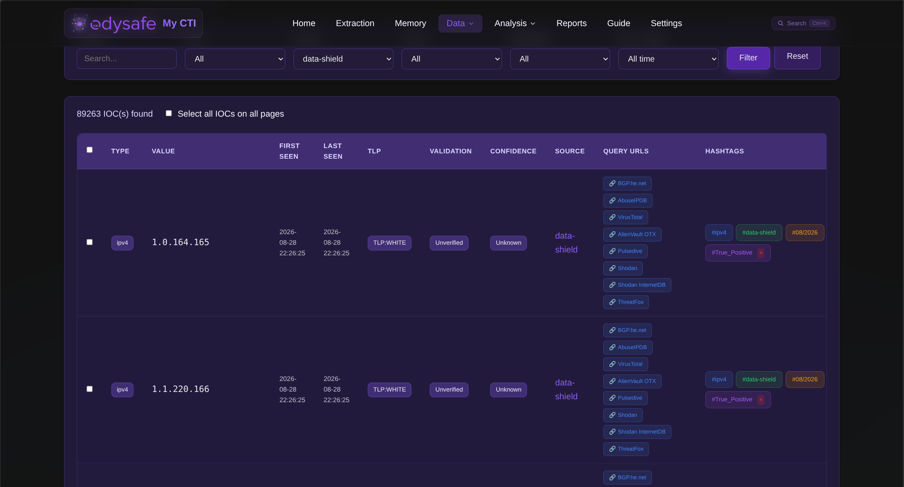
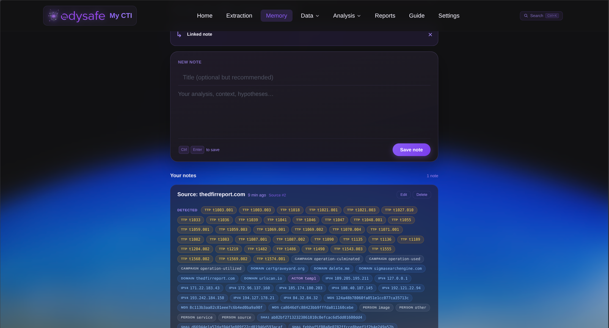
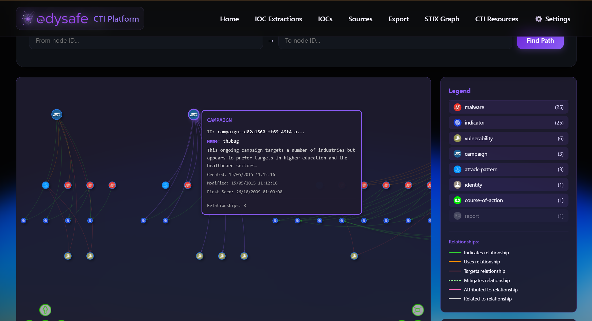
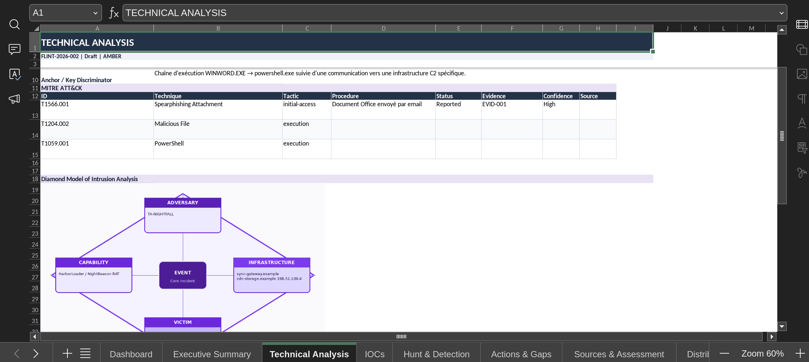

# ODYSAFE CTI

**ODYSAFE CTI** is an open-source, local-first Cyber Threat Intelligence platform designed to bring collection, analysis, investigation, memory, STIX, MITRE ATT&CK, IOC management, and reporting into a single workspace.

It is intended for analysts who want to keep their intelligence data under their own control while reducing fragmentation between collection, context, investigation, operationalization, and reporting.

> Local-first • Analyst-driven • Open source • No mandatory cloud dependency

---

## Overview

ODYSAFE CTI provides a unified workspace for the main stages of a CTI workflow:

- collect intelligence from files, text, URLs, STIX bundles, and CTI resources;
- extract and manage indicators at scale;
- organize sources and investigation context;
- preserve analyst notes, entities, and relationships in local Memory;
- analyze STIX objects and MITRE ATT&CK behavior;
- explore ransomware and community CTI resources;
- prepare structured operational Intelligence Workspace reports;
- export intelligence for further analysis, hunting, detection, or sharing.

The in-app product guide is available from the navigation bar or directly at `/onboarding`.

---

## What You Can Do

- **See the graph**: open a STIX bundle and explore objects, links, and context.
- **Extract fast**: pull IOCs from files, pasted text, URLs, and reports.
- **Sort the noise**: group sources, filter IOCs, tag what matters, and remove false positives.
- **Investigate better**: link notes, IOCs, TTPs, sources, gaps, and evidence.
- **Map behavior**: connect IOCs and reports to MITRE ATT&CK techniques.
- **Track clusters**: build profiles for activity, infrastructure, phishing, malware, campaigns, or actors.
- **Write clean reports**: turn an investigation into a structured Excel or JSON workspace.
- **Export and share**: produce IOC exports, STIX outputs, Excel workbooks, and reusable workspaces.

---

## IOC Workspace

ODYSAFE centralizes extracted indicators in a searchable workspace.

It supports more than 50 IOC and observable types, including network indicators, hashes, CVEs, ATT&CK techniques, identifiers, communication artifacts, blockchain addresses, and other structured values.

Indicators can be filtered, grouped, validated, contextualized, linked to external analysis resources, and reused throughout the platform.



---

## CTI Memory

The **Memory** workspace provides a local analyst knowledge layer for notes, IOCs, TTPs, sources, entities, hypotheses, and investigation context.

It is designed to help analysts recover previous observations, reconnect related information, and preserve useful context across investigations.



---

## Analysis & Investigation

ODYSAFE combines several CTI analysis capabilities in the same workspace.

The analysis area includes:

- **STIX Graph** for visual exploration of STIX 2.0 / 2.1 objects and relationships;
- **Profiles & Clusters** for analyst-maintained persistent CTI knowledge objects such as activity clusters, infrastructure clusters, campaigns, malware clusters, phishing clusters, and actor profiles;
- **MITRE ATT&CK** for techniques, groups, behavior mapping, IOC relationships, IOC-linked Navigator exports, and actor ATT&CK technique snapshots;
- **DeepDarkCTI** for browsing community CTI resources;
- **Ransomware Tool Matrix** for ransomware tooling, group profiles, intelligence resources, and defensive research;
- local IOC, source, and Memory context reusable during investigations.

STIX content can be imported, explored, connected to observables, saved, validated, and exported again.

Profiles & Clusters are saved as a SQLite-backed JSON workspace, with browser localStorage used as fallback recovery. Demo profiles are loaded only when the analyst explicitly chooses **Load Demo Data**. The list view can export a JSON workspace snapshot; Excel export is available only from an opened profile so each workbook represents one specific profile context.

MITRE ATT&CK exports are scoped to techniques linked to IOCs in the current workspace. Actor ATT&CK snapshots show ATT&CK group techniques and their overlap with ODYSAFE workspace techniques; technique overlap is contextual information and must not be interpreted as actor attribution.



---

## Intelligence Workspace Reports

ODYSAFE includes a structured **Intelligence Workspace** for turning collected intelligence into an operational CTI product.

A report can bring together:

- metadata and intelligence requirements;
- collection and data availability planning;
- threat or activity classification;
- executive summary and key judgements;
- timeline and technical analysis;
- MITRE ATT&CK procedures and attack sequence;
- indicators, artifacts, operational context, validation freshness, false-positive risk, and recommended use;
- detection content, telemetry requirements, hunt leads, and hunt results;
- actions and intelligence gaps;
- analytic assessment and confidence;
- analyst tradecraft context, including analytic claims, evidence/source references, internal relevance, investigation journal entries, quality checks, and handoff notes;
- sources, provenance, and distribution instructions;
- sharing review and feedback/closure context.

Reports can be saved as authoritative SQLite-backed JSON workspaces, restored, reused, indexed in CTI Memory on save, exported to Excel, or exported as a JSON workspace snapshot. Browser localStorage is used for draft recovery, not as the only saved state. Evidence Register entries make `EVID-*` references resolvable in the workspace and Excel export.

The workspace sidebar separates analyst work coverage from publication readiness. **Analyst Progress** tracks whether Purpose, Collection, Analyze, Relevance, Investigate, Assess, Act, Deliver, and Close have enough documented coverage for the current requirement. It is not an analysis quality score and does not decide whether the assessment is true.

The workspace adapts readiness expectations to the selected product type without hiding sections. Required, recommended, and optional section badges help analysts focus on the fields that matter for the current product.

ODYSAFE also preserves a semantic contract across UI, JSON, and Excel exports: unknown, not assessed, not applicable, reported, observed, inferred, source reliability, information credibility, indicator match, publication readiness, and external attribution keep distinct meanings.

The Intelligence Workspace includes a clearly labeled sample workspace loaded through **Load Sample**. It uses fictitious reserved values only and is not linked to imported IOC records; analysts can load it, edit it, save it as their own workspace, or export it to Excel as a reusable example.

The lightweight tradecraft conventions used by Intelligence Workspace reports are documented in `docs/analyst-tradecraft.md`.

Intelligence Workspace reports can also compare selected ATT&CK TTPs with explicit Sigma ATT&CK tags entered in detection rules. This is a Sigma ATT&CK mapping check, not proof of deployed detection coverage.

Source management includes exact-content duplicate detection, portable source bundles, and cross-source overlap views. Overlap source counts represent recurrence across ODYSAFE sources, not independent corroboration.

Settings include a local health check for SQLite, upload/output folders, storage usage, MITRE ATT&CK data, and SSL files.



---

## Local-First Architecture

ODYSAFE is designed to run on-premise and keep operational CTI data under local control.

Application data, analyst context, reports, IOC exports, STIX bundles, uploads, and runtime resources remain inside the local installation environment.

The platform does not require a hosted ODYSAFE backend or mandatory telemetry service.

---

## Acknowledgements

ODYSAFE CTI thanks the open-source projects, public datasets, and community repositories that make local CTI work stronger:

- **MITRE ATT&CK** and `attack-stix-data` for ATT&CK techniques, groups, and STIX knowledge.
- **DeepDarkCTI** by `fastfire` for community CTI source references.
- **Ransomware Tool Matrix** by `BushidoUK` for ransomware tooling and research references.
- **Data-Shield IPv4 Blocklist** for defensive IPv4 blocklist data.
- **ZettelForge** for local CTI Memory concepts and storage integration.
- **STIX / TAXII ecosystem libraries** used to parse, model, and export structured CTI.
- **vis-network** for interactive graph visualization.
- **Flask, SQLite, Python, and the wider open-source Python ecosystem** for the local application foundation.

These projects remain independent from ODYSAFE. ODYSAFE uses them as local data, libraries, or reference sources where applicable.

---

# Installation

Clone the repository:

```bash
git clone https://github.com/Odysafe/ODYSAFE-CTI.git
cd ODYSAFE-CTI
```

ODYSAFE provides a standard installation path and an optional service-management path.

## Standard installation

Make the installer executable:

```bash
chmod +x install.sh
```

Run it:

```bash
./install.sh
```

Then start ODYSAFE:

```bash
chmod +x start.sh
./start.sh
```

By default, ODYSAFE uses port `5001`.

When HTTPS is enabled:

```text
https://localhost:5001
```

---

## Docker Linux installation

Use this path when you want a Linux container that installs ODYSAFE, preloads the pinned CTI data repositories, generates HTTPS certificates, and starts ODYSAFE as a supervised background service when the container starts.

From the repository root:

```bash
cd scripts
./build-docker-linux.sh
```

By default, the script builds the `odysafe-cti:local` image, starts a container named `odysafe-cti`, and exposes ODYSAFE on:

```text
https://localhost:5001
```

View container logs with:

```bash
docker logs -f odysafe-cti
```

---

## Optional service mode

The service script is **not mandatory**.

It is useful when you want ODYSAFE to run as a managed service instead of launching it manually with `./start.sh`.

Make the script executable:

```bash
chmod +x scripts/install-service.sh
```

Then install the service:

```bash
./scripts/install-service.sh install
```

The script automatically detects the available service mechanism:

- **systemd** on supported Debian/Ubuntu hosts;
- **SysV / service** in environments where systemd is unavailable, including compatible containers.

The service script expects the ODYSAFE Python environment to already exist. If `venv/` has not yet been created, run `./install.sh` first.

Manage the service with:

```bash
./scripts/install-service.sh status
./scripts/install-service.sh restart
./scripts/install-service.sh logs
./scripts/install-service.sh remove
```

On SysV-compatible environments, the generated service can also be controlled with:

```bash
service odysafe-cti start
service odysafe-cti stop
service odysafe-cti restart
service odysafe-cti status
```

---

## Requirements

Recommended environment:

- Linux
- Python 3.10+
- `pip`
- `git`
- `openssl`
- `libmagic`

The standard installer prepares the Python environment, dependencies, runtime directories, TLS material, and optional CTI datasets used by the platform.

---

## Main Local Data Paths

Runtime data is stored under the local installation directory, including:

```text
cti-platform/database/
cti-platform/uploads/
cti-platform/outputs/iocs/
cti-platform/outputs/stix/
cti-platform/outputs/reports/
cti-platform/data/zettelforge/
cti-platform/ssl/
```

Operational databases, generated certificates, analyst notes, uploaded intelligence, reports, logs, backups, caches, and other runtime data should not be committed to the public repository.

### Offline Dataset Placement

When ODYSAFE is deployed without internet access, place optional datasets at these paths before restarting the platform:

```text
docs/enterprise-attack.json
cti-platform/modules/deepdarkCTI-main/
cti-platform/modules/Ransomware-Tool-Matrix-main/
cti-platform/modules/data_shield/prod_data-shield_ipv4_blocklist.txt
cti-platform/modules/cache/
```

- `docs/enterprise-attack.json`: MITRE ATT&CK Enterprise STIX JSON bundle.
- `cti-platform/modules/deepdarkCTI-main/`: local clone or copy of `fastfire/deepdarkCTI`.
- `cti-platform/modules/Ransomware-Tool-Matrix-main/`: local clone or copy of `BushidoUK/Ransomware-Tool-Matrix`.
- `cti-platform/modules/data_shield/prod_data-shield_ipv4_blocklist.txt`: Data-Shield IPv4 blocklist text file.
- `cti-platform/modules/cache/`: local cache, favorites, manual source files, and deleted source metadata.

---

## Repository Structure

```text
ODYSAFE-CTI/
├── cti-platform/
│   ├── app.py
│   ├── database.py
│   ├── modules/
│   ├── static/
│   ├── templates/
│   ├── uploads/
│   └── outputs/
├── docs/
│   ├── analyst-tradecraft.md
│   └── images/
│       ├── exemple-report.png
│       ├── IOCs.png
│       ├── Memory.png
│       └── stix graph.png
├── scripts/
│   ├── install-service.sh
│   ├── requirements.txt
│   ├── requirements.lock
│   └── pinned_sources.json
├── install.sh
├── start.sh
├── uninstall.sh
├── README.md
├── LICENSE
└── COPYING
```

---

## Security & Privacy

Before publishing or redistributing a deployment, review the repository for:

- API keys and credentials;
- `.env` files;
- private keys and certificates;
- local databases;
- analyst notes;
- uploaded intelligence;
- generated reports;
- logs and backups;
- temporary files;
- Python caches such as `__pycache__` and `*.pyc`.

Private operational data should remain outside version control.

---

## Open Source

ODYSAFE CTI is distributed as an open-source project.

Repository:

**https://github.com/Odysafe/ODYSAFE-CTI**

Contributions, testing, issue reports, and improvements are welcome.
