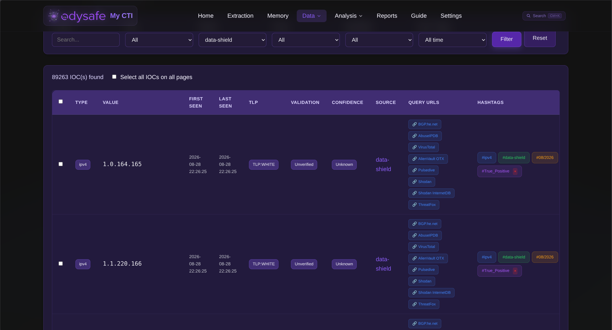
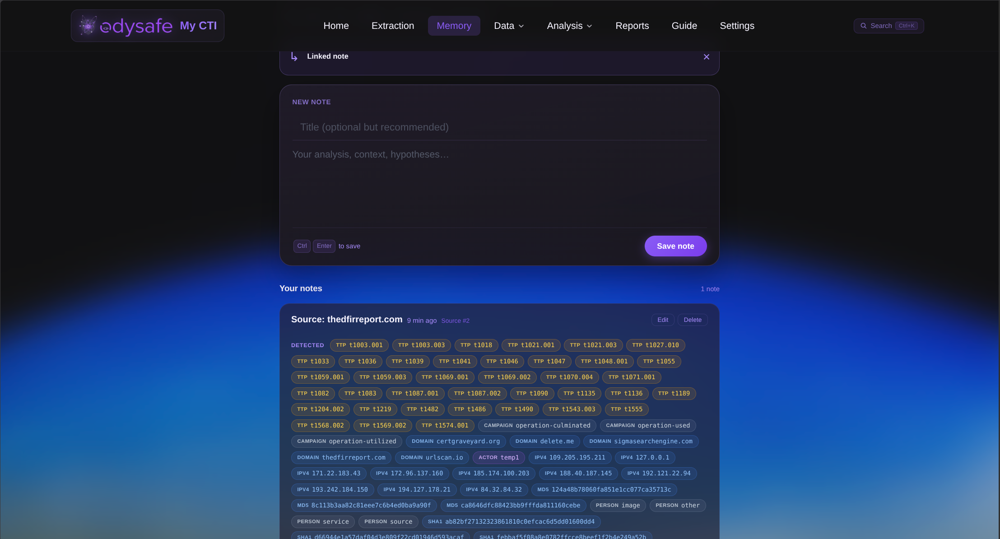
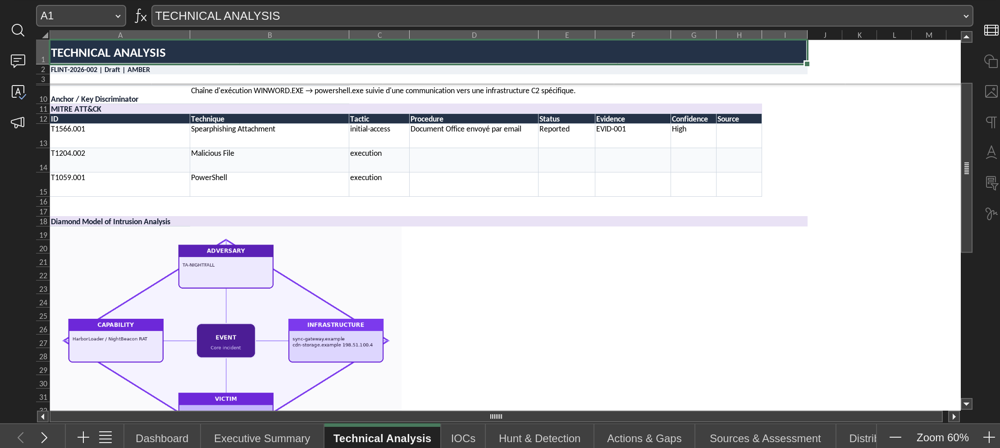

<div align="center">


# ODYSAFE-CTI

**Extract indicators, connect them to evidence, and prepare analyst reports.**

`SELF-HOSTED` · `IOC / STIX / ATT&CK` · `JSON / EXCEL` · `EN / FR`

[**Install**](#quick-start) · [Screenshots](#interface-preview) · [Start & stop](#everyday-commands) · [Offline data](#optional-offline-data-pack) · [Reports](#analyst-workflow) · [Credits](#acknowledgements)

</div>

> **Linux x86‑64 · Docker Engine 28+ · Compose 2.20.2+**
>
> The offline archive includes **ZettelForge 2.8.0 and its Nomic model**.

## Interface preview

<table>
<tr>
<td width="50%" align="center"><a href="docs/images/IOCs.png"></a><br><br><b>IOC workspace</b><br>Review extracted indicators and source context.</td>
<td width="50%" align="center"><a href="docs/images/Memory.png"></a><br><br><b>CTI Memory</b><br>Review notes and retrieve local knowledge.</td>
</tr>
<tr>
<td width="50%" align="center"><a href="docs/images/stix%20graph.png"></a><br><br><b>STIX graph</b><br>Explore relationships between CTI objects.</td>
<td width="50%" align="center"><a href="docs/images/exemple-report.png"></a><br><br><b>Intelligence Workspace</b><br>Prepare the assessment and analyst handoff.</td>
</tr>
</table>

<p align="center"><sub>Click any preview to view the full image.</sub></p>

<a id="quick-start"></a>

## Install and open CTI

| Installation | What you need |
|:--|:--|
| **From Git** | Docker, Compose, Git and Internet access for the first build |
| **From the offline archive** | Docker, Compose, the application archive and its checksum |

<details>
<summary><b>Check the Docker host</b></summary>

```sh
uname -m
docker version --format '{{.Server.Version}}'
docker compose version
```

Provision Docker and Compose before disconnecting an offline host. [Docker Engine](https://docs.docker.com/engine/install/) · [Compose plugin](https://docs.docker.com/compose/install/linux/)

</details>

### A · From Git

```sh
git clone https://github.com/Odysafe/ODYSAFE-CTI.git
cd ODYSAFE-CTI
./start.dh
```

The first build fetches and bundles the pinned model. Memory then uses the local copy.

<a id="b--install-the-offline-package"></a>

### B · From the offline archive

From [GitHub Releases](https://github.com/Odysafe/ODYSAFE-CTI/releases/tag/v1.0.9), transfer the **1.0.9 application archive** and its **.sha256** file. Run these commands from the directory containing both files.

```sh
sha256sum -c odysafe-cti-1.0.9-linux-amd64.tar.gz.sha256 &&
mkdir cti-1.0.9 &&
tar -xzf odysafe-cti-1.0.9-linux-amd64.tar.gz -C cti-1.0.9 &&
cd cti-1.0.9/odysafe-cti &&
./start.dh --offline
```

### First launch

1. Choose **HTTPS** or **HTTP**. HTTPS is the default. Open the URL printed in the terminal. With HTTPS, the browser may ask you to accept the local certificate.
2. On a connected host, select any optional downloads. In offline mode, [transfer the datasets locally](#optional-offline-data-pack).
3. In **Extraction → Paste**, test with `Test indicator: example.net`. Check **Data → IOCs**. Language and authentication are under **Settings**.

[Native installation and service management](docs/install-native.md)

<a id="everyday-commands"></a>

## Start, stop and inspect

Run these from the application directory. If you customized `CTI_STATE_DIR` or `COMPOSE_PROJECT_NAME`, use the same values for every command.

| Task | Command |
|:--|:--|
| Start or resume | `./start.dh` |
| Start with network isolation | `./start.dh --offline` |
| Stop CTI and its relay | `./stop` |
| Check both containers | `./tools/status.sh` |
| Follow application logs | `./tools/logs.sh -f` |
| Set HTTP or HTTPS | `./start.dh --http` or `./start.dh --https` |
| Verify the bundled Memory model | `./tools/prepare-memory.sh --offline` |
| Clear regenerable caches after stopping | `./tools/clear-cache.sh` |

<a id="stop-and-restart-docker"></a>

<details>
<summary><b>Remove Docker containers and networks</b></summary>

To remove the containers and their Compose networks as well, use the same workspace path and Compose project name used at startup. Run the following from the application directory:

```sh
export CTI_STATE_DIR="${CTI_STATE_DIR:-${XDG_DATA_HOME:-$HOME/.local/share}/odysafe-cti}"
export CTI_UID="$(id -u)" CTI_GID="$(id -g)"
docker compose down
```

The workspace and downloaded image remain available after `down`. If you configured a custom `CTI_STATE_DIR` or `COMPOSE_PROJECT_NAME`, export those original values before running any stop, status or restart command.

</details>

<a id="how-it-works"></a>

## Network access and workspace

The Docker relay serves the interface on `127.0.0.1:5001`. In normal mode, CTI accesses the Internet for public HTTP(S) imports and for updates you request for **ATT&CK**, **DeepDarkCTI**, **Ransomware Tool Matrix** or **Data-Shield**. Use `--offline` for network isolation. Local imports, Memory and reporting work in both modes.

<details>
<summary><b>Workspace paths and permissions</b></summary>

Docker runs the services with the UID and GID of the host user who starts them. State is stored in `${XDG_DATA_HOME:-$HOME/.local/share}/odysafe-cti` by default. Set `CTI_STATE_DIR` to an absolute path to select another workspace. Use an independent state path, Compose project name and port if testing another instance alongside your main workspace.

| Path under `CTI_STATE_DIR` | Contents |
| --- | --- |
| `database/`, `uploads/`, `outputs/` | SQLite workspace, input files and generated exports |
| `zettelforge/` | CTI Memory notes, graph and vector data |
| `cache/` | Source preferences, favorites, manual entries and derived catalogs |
| `docs/`, `datasets/`, `data_shield/` | Local intelligence snapshots |
| `ssl/` | Private TLS key, certificate and session secret |

The application archive lives separately from this state. `./stop` stops the services. The cache purge removes regenerated catalogs and Python bytecode while retaining state, source preferences and the offline model.

</details>

<a id="optional-offline-data-pack"></a>

## Add intelligence data offline

Memory is ready with the Docker image. Transfer only the extra intelligence sources you want.

| Dataset | Path under `CTI_STATE_DIR` |
|:--|:--|
| MITRE ATT&CK Enterprise 20.1 | `docs/enterprise-attack.json` |
| DeepDarkCTI | `datasets/deepdarkCTI-main/` with its `.git/` |
| Ransomware Tool Matrix | `datasets/Ransomware-Tool-Matrix-main/` with its `.git/` |
| Data-Shield IPv4 | `data_shield/prod_data-shield_ipv4_blocklist.txt` |

<details>
<summary><b>Install the ATT&CK snapshot from data pack 1.0.1</b></summary>

Use data pack **1.0.1** to stage **MITRE ATT&CK Enterprise 20.1** offline. It also carries a model copy for older versions. Docker **1.0.9** already includes ZettelForge and its Nomic model.

Place the two data-pack files in the same parent transfer directory used in the [archive example](#b--install-the-offline-package). Run the following from that transfer directory, with CTI stopped. Set `CTI_STATE_DIR` to your existing path if you changed it for your installation.

```sh
sha256sum -c odysafe-cti-data-1.0.1.tar.gz.sha256 &&
tar -xzf odysafe-cti-data-1.0.1.tar.gz
```

For a **new workspace**, run this from the same transfer directory.

```sh
export CTI_STATE_DIR="${CTI_STATE_DIR:-${XDG_DATA_HOME:-$HOME/.local/share}/odysafe-cti}"
mkdir -p "$CTI_STATE_DIR/docs"
cp -n odysafe-cti-data/docs/enterprise-attack.json "$CTI_STATE_DIR/docs/"
mkdir -p "$CTI_STATE_DIR/third-party-notices"
cp -an odysafe-cti-data/licenses/. "$CTI_STATE_DIR/third-party-notices/"
```

For an **existing workspace with an older ATT&CK file**, retain a copy and replace it explicitly. Set `CTI_STATE_DIR` as above and run from the same transfer directory. IOC-to-technique links are stored in SQLite.

```sh
cp "$CTI_STATE_DIR/docs/enterprise-attack.json" "$CTI_STATE_DIR/docs/enterprise-attack.json.backup" &&
cp odysafe-cti-data/docs/enterprise-attack.json "$CTI_STATE_DIR/docs/enterprise-attack.json.new" &&
mv "$CTI_STATE_DIR/docs/enterprise-attack.json.new" "$CTI_STATE_DIR/docs/enterprise-attack.json"
```

Return to the application directory and restart CTI. The optional diagnostic verifies the built-in model with networking disabled. The example uses the archive layout above:

```sh
cd cti-1.0.9/odysafe-cti
./start.dh --offline
./tools/prepare-memory.sh --offline
```

The model check should report `Embedding ready`. In the interface, open **Analysis → MITRE ATT&CK** to confirm **20.1**, and **Memory** to check availability. Use a consistent pack on all test or production hosts.

</details>

<a id="transfer-git-datasets-to-an-offline-host"></a>

<details>
<summary><b>Transfer the Git catalogs and stage Data-Shield</b></summary>

**On a connected staging machine**, prepare the two complete Git checkouts. Use a new transfer directory and the commits recorded in the release. Git is needed here on the staging machine.

```sh
mkdir -p cti-dataset-transfer
cd cti-dataset-transfer
git clone https://github.com/fastfire/deepdarkCTI.git deepdarkCTI-main &&
git -C deepdarkCTI-main checkout --detach b8ef1bee423cfa30233ad4dd22dbe5562d935d2d &&
git clone https://github.com/BushidoUK/Ransomware-Tool-Matrix.git Ransomware-Tool-Matrix-main &&
git -C Ransomware-Tool-Matrix-main checkout --detach bbdd31db57c1621e0bef3da04ca873fc2fc174f7 &&
tar -czf cti-git-datasets.tar.gz deepdarkCTI-main Ransomware-Tool-Matrix-main &&
sha256sum cti-git-datasets.tar.gz > cti-git-datasets.tar.gz.sha256
```

Copy the archive and the checksum to the offline host. The tar archive preserves the hidden `.git` directories CTI uses to recognize each repository. Use standalone clones so their Git objects travel with them.

**On the offline Docker host**, stop CTI from its application directory and return to the directory containing the two transferred files. Run the commands as the same Linux user who starts CTI. If you use a custom `CTI_STATE_DIR`, export it before stopping or unpacking. For a first installation or an empty datasets directory, run:

```sh
export CTI_STATE_DIR="${CTI_STATE_DIR:-${XDG_DATA_HOME:-$HOME/.local/share}/odysafe-cti}"
sha256sum -c cti-git-datasets.tar.gz.sha256 &&
mkdir -p "$CTI_STATE_DIR/datasets" &&
test ! -e "$CTI_STATE_DIR/datasets/deepdarkCTI-main" &&
test ! -e "$CTI_STATE_DIR/datasets/Ransomware-Tool-Matrix-main" &&
tar -xzf cti-git-datasets.tar.gz -C "$CTI_STATE_DIR/datasets"
```

For a replacement, stop CTI, back up the workspace, and move each existing checkout out of `datasets/` before unpacking. Keep the two checkout directories directly inside `datasets/`. The result should be:

```text
CTI_STATE_DIR/
├── datasets/
│   ├── deepdarkCTI-main/.git/
│   └── Ransomware-Tool-Matrix-main/.git/
├── docs/enterprise-attack.json
└── data_shield/prod_data-shield_ipv4_blocklist.txt
```

ATT&CK comes from the optional data pack. Docker supplies the Memory model. The Data-Shield file is also optional. To stage it manually, copy the trusted IPv4 list into `$CTI_STATE_DIR/data_shield/` using the filename shown above. To ingest the local file as IOCs, call the authenticated endpoint `POST /api/data-shield/import`. This endpoint reads the staged file. The dashboard refresh controls are for remote updates.

Return to the application directory and run `./start.dh --offline`. Open **Analysis → DeepDarkCTI** and **Analysis → Ransomware Tool Matrix**, then confirm that entries from each checkout are visible. A repository ZIP without `.git`, an extra parent directory or incorrect capitalization prevents recognition. In a native installation, use the paths in the native guide. [Pinned upstream sources](scripts/pinned_sources.json) · [Native dataset paths](docs/install-native.md#offline-dataset-placement)

</details>

<a id="analyst-workflow"></a>

## From import to report

Import a document, paste text or submit a public URL. Review the extracted indicators and keep their source context.

| Deliverable | Where to find it |
|:--|:--|
| **Automatic IOC inventory** | Enable **Settings → Automatic IOC reports**. An import that adds indicators writes JSON to **Settings → Recent outputs** and `outputs/reports/`. |
| **Analyst report** | Open **Reports → Intelligence Workspace**. Add evidence and source references, run **Quality Check**, then save or export JSON or Excel. |

[Feature guide](docs/features.md) · [Analyst tradecraft guide](docs/analyst-tradecraft.md)

<details>
<summary><b>Batch import Sigma or YARA into Memory</b></summary>

The authenticated endpoint `POST /memory/api/ingest/batch` accepts one multipart `file` field per single-rule Sigma or YARA file and returns a result per file. YARA validation defaults to `warn`. Use `tier=strict` for strict CCCS validation.

</details>

## Back up, update and recover

**Before updating**, run from your current application directory.

```sh
mkdir -p "$HOME/cti-backups"
backup_path="$HOME/cti-backups/cti-$(date +%Y%m%d-%H%M%S).tar.gz"
./stop && ./tools/backup.sh "$backup_path"
```

Keep the archive and checksum together. The backup contains the workspace and private TLS and session material.

| Installation | Update |
|:--|:--|
| Git checkout | With a clean tree on `main`, run `git pull --ff-only origin main && ./start.dh --build`. |
| Offline archive | Verify and extract the replacement into a fresh directory, then run `./start.dh --offline`. |

Reuse the original state path and project name. Check a known IOC, a Memory note and a local export before removing the old installation files or unused Docker image.

<details>
<summary><b>Restore or roll back to the previous version</b></summary>

Stop CTI. From the application directory for the version that should open the backup, choose a state path that **does not exist yet**. For rollback, use the previous application directory and the backup taken before updating. Example for the archive path:

```sh
./stop
export CTI_STATE_DIR="$HOME/cti-restored-$(date +%Y%m%d-%H%M%S)"
./tools/restore.sh "$backup_path" &&
./start.dh --offline
```

Set `backup_path` to the full archive path if restoring in another shell. From a source checkout with a prebuilt image you can also use `./start.dh --offline`. Otherwise, build that version on a connected machine first. After restoration, confirm the expected IOC, linked files and Memory notes before using the restored workspace.

**Settings → Backup & Restore** provides an application-level export and merge. Use the stopped-state archive above when you need to move or recover the whole installation, including uploaded files and TLS material.

</details>
<details>
<summary><b>Migrate a legacy Docker container</b></summary>

From the new application directory, identify the old container and verify that it contains a workspace you want to migrate. Stop it and choose an unused `CTI_STATE_DIR`. The migration expects a stopped legacy container with a SQLite workspace.

```sh
docker stop odysafe-cti
export CTI_STATE_DIR="$HOME/odysafe-cti-migrated"
./tools/migrate-legacy.sh odysafe-cti
./start.dh --offline
```

Use the actual old container name if it differs. The example assumes the new application image is already available or bundled. The script copies the database, reports, uploads, Memory and available datasets. It retains the legacy container for rollback. If the old container was never initialized and has no SQLite workspace, follow the fresh-install path.

</details>

## Troubleshooting

| Symptom | Check |
|:--|:--|
| Cannot reach the interface | Run `./tools/status.sh`. Use the protocol and port printed by the launcher. Try another port with `CTI_HOST_PORT=5501 ./start.dh --offline`. |
| Docker socket access denied | Run `docker version` as your CTI user and verify Docker access. |
| URL import or dataset update blocked | Use `./start.dh` on a connected host, or transfer the file to your offline workspace. |
| Catalog empty | Check the [dataset paths](#optional-offline-data-pack), directory capitalization and the hidden `.git/` folders. |
| Archive fails verification | Copy the archive and its matching checksum again. |
| Memory unavailable | Run `./tools/prepare-memory.sh --offline` to check the built-in model. |

<details>
<summary><b>Build an offline release</b></summary>

On a connected Linux x86-64 host, set the image tag consistently in `release-images.env` and `compose.yaml`. Use the version matching your image tag in the archive filename. This example writes to a new directory under `dist/`, so repeated builds preserve previous artifacts.

```sh
./start.dh --build-only
mkdir -p dist
release_dir=$(mktemp -d "$PWD/dist/cti-build.XXXXXX")
./tools/package-offline.sh "$release_dir/odysafe-cti-1.0.9-linux-amd64.tar.gz"
printf '%s\n' "$release_dir"
# Optional data pack rebuild. Requires curl, Python 3 and upstream access.
./tools/package-data.sh "$release_dir/odysafe-cti-data-1.0.1.tar.gz"
```

The application archive contains the image, Compose configuration, scripts, documentation, corresponding source and a release inventory. Application state is backed up separately. On a test host, verify clean offline startup, both staged Git catalogs, a local IOC import with its JSON inventory, an Excel export, Memory with the built-in model, and backup restoration before publishing or adopting a new Docker Engine, Compose or Linux host. Refresh the pinned base image and Python lock deliberately when maintaining a new release.

</details>

<a id="acknowledgements"></a>

## Credits

Thanks to the open-source projects and data maintainers whose work makes ODYSAFE‑CTI possible.

| Area | Projects and contributors |
|:--|:--|
| IOC extraction and document reading | [MaliciaLab / iocsearcher](https://github.com/malicialab/iocsearcher), Beautiful Soup, lxml, pdfminer.six, docx2python, ReadabiliPy and libmagic |
| Memory and embeddings | [ThreatRecall / ZettelForge](https://github.com/ThreatRecall/zettelforge), Nomic AI’s Nomic Embed Text, FastEmbed, ONNX Runtime, Hugging Face Hub, LanceDB and Lance |
| Threat intelligence data | MITRE ATT&CK and attack-stix-data, fastfire and the DeepDarkCTI contributors, BushidoUK and the Ransomware Tool Matrix contributors, and duggytuxy and the Data-Shield IPv4 Blocklist contributors |
| Intelligence formats and detection rules | OASIS CTI and the Python STIX 2 libraries, SigmaHQ, the YARA project and the Canadian Centre for Cyber Security |
| Graphs and reports | vis-network, openpyxl and Pillow |
| Application and deployment | Python, Flask, Werkzeug, Jinja, Gunicorn, SQLite, Requests, OpenSSL, Debian, Docker Engine, BuildKit and Docker Compose |
| Distribution and community | Git, GitHub and the maintainers of the dependencies listed in the lockfile |

[AGPL‑3.0 license](LICENSE) · [Pinned dependencies](scripts/requirements.lock) · [Pinned dataset sources](scripts/pinned_sources.json)
